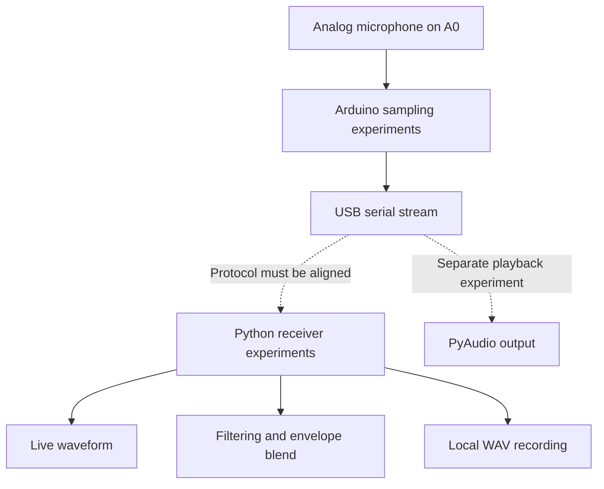

# Stethalyser

An exploratory digital stethoscope project: capture an analog microphone signal with Arduino, stream samples over serial, and inspect the waveform in Python. The source explores sampling, live visualization, filtering, buffered recording, and audio playback.

The Arduino sketches and Python receivers are separate experiments. Their sample rates and byte formats do not yet form a compatible end-to-end pipeline. See the [protocol comparison](docs/EXPERIMENTS.md) before connecting hardware.

## What's in the source

- `stethoscope_monitor.py`: serial capture, Matplotlib waveform, SciPy filtering, envelope blending, and WAV output.
- `no filter.py`: a receiver and recording variant without the filter stage.
- `MacBook Audio Playback Script.py`: a direct serial-to-PyAudio playback experiment.
- Three Arduino sketches: two binary sampling variants and a simple text stream for plotting.

## Exploring the project

The stack is Python, NumPy, SciPy, Matplotlib, pyserial, PyAudio, and Arduino C++. Dependencies are inferred from imports; no pinned environment or hardware setup is supplied. Replace `/dev/tty.YOUR_DEVICE` with a local serial device only after selecting a compatible sender/receiver protocol.

Read the [experiment notes](docs/EXPERIMENTS.md) for configuration details and known implementation gaps. Some scripts open devices immediately when executed; they are not safe library entry points. Hardware capture, playback, signal quality, and timing have not been verified for this snapshot. No new runtime tests were performed during portfolio packaging.

This is an audio acquisition prototype, not a diagnostic tool or a validated heart/lung sound classifier. No patient audio or real recordings are included. Original code by Ved Sarkar; see [attribution and license status](ATTRIBUTION.md).
